

# MuoniumPlayer

**把音乐装进 Minecraft。**

*A full-featured in-game music player for Minecraft — NetEase Cloud Music, QQ Music, Kugou, Qishui, YouTube Music, Bilibili, Spotify. Word-by-word lyrics, 3D world lyrics, ViPER audio effects, gapless automix, listen-together rooms. Fabric / Forge / NeoForge, Windows / Linux / macOS / Android.*

一个 Minecraft 客户端 Mod：手机音乐 App 般的播放器、逐字歌词、灵动岛、一起听房间、无缝切歌 —— 全部画在游戏里，不弹浏览器、不切窗口。 
纯客户端，普通服务器**不用装任何东西**。

技术问题、玩法交流、抢先看新版本 —— <a href="https://qm.qq.com/q/uNHkCoTusU">点此加群</a>

[演示](#演示) &nbsp;·&nbsp; [音源](#8-个聚合音源一个播放器) &nbsp;·&nbsp; [LX 脚本](#lx-自定义脚本音源) &nbsp;·&nbsp; [音效](#音效系统蝰蛇音效--jamesdsp-混响) &nbsp;·&nbsp; [一起听](#一起听三种开法两种不需要服务端) &nbsp;·&nbsp; [汽水](#汽水音乐用你自己的会员听完整版) &nbsp;·&nbsp; [版本](#支持的版本) &nbsp;·&nbsp; [安装](#安装三步装好) &nbsp;·&nbsp; [赞助](#赞助)

---

## 演示

<table>
<tr>
<td width="50%" valign="top">
<a href="assets/videos/欢迎.mp4">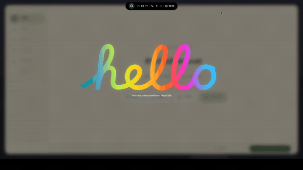</a>

<b>首启欢迎</b> —— 彩虹描字，一个字母一个字母写出来 <a href="assets/videos/欢迎.mp4">完整视频 0:14</a>

</td>
<td width="50%" valign="top">
<a href="assets/videos/全屏歌词展示.mp4">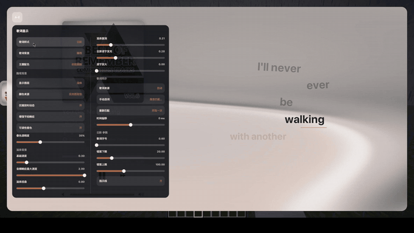</a>

<b>全屏歌词</b> —— 十种排版样式，每种带独立参数 <a href="assets/videos/全屏歌词展示.mp4">完整视频 0:47</a>

</td>
</tr>
</table>

<a href="assets/videos/3D歌词展示.mp4">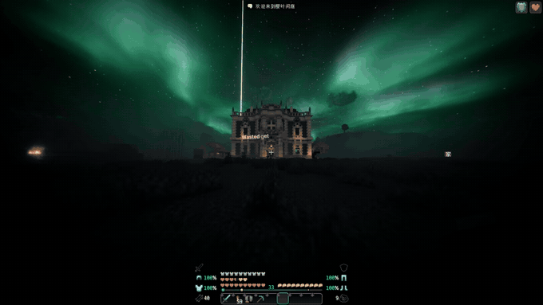</a>

<b>3D 世界歌词</b> —— 逐字字形画进游戏世界，不再被框在 GUI 里　·　<a href="assets/videos/3D歌词展示.mp4">完整视频 2:07</a>

 

<table>
<tr>
<td width="50%" valign="top">
<a href="assets/videos/自动换源展示.mp4">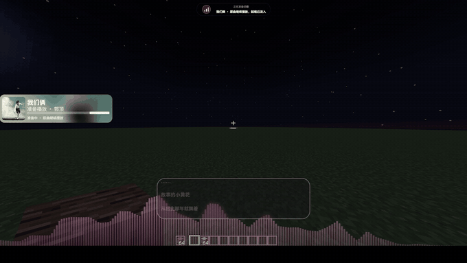</a>

<b>自动换源</b> —— 灰歌跨平台匹配替身流，毫秒级亮起 <a href="assets/videos/自动换源展示.mp4">完整视频 0:58</a>

</td>
<td width="50%" valign="top">
<a href="assets/videos/心象歌词展示.mp4">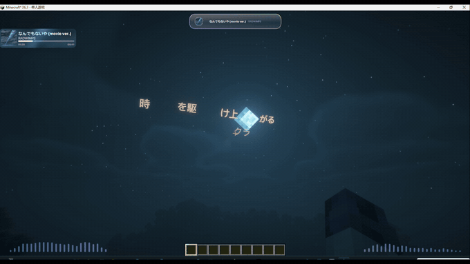</a>

<b>律动词云·心象</b> —— 逐字飞散、聚拢、有序落位 <a href="assets/videos/心象歌词展示.mp4">完整视频 0:29</a>

</td>
</tr>
<tr>
<td width="50%" valign="top">
<a href="assets/videos/绘光歌词效果展示.mp4">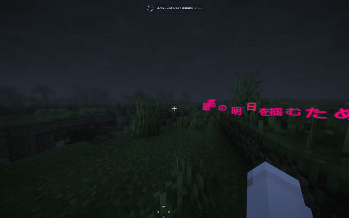</a>

<b>绘光歌词</b> —— 逐字贝塞尔飞行与回溯径迹 <a href="assets/videos/绘光歌词效果展示.mp4">完整视频 1:34</a>

</td>
<td width="50%" valign="top">
<a href="assets/videos/手机版效果展示.mp4">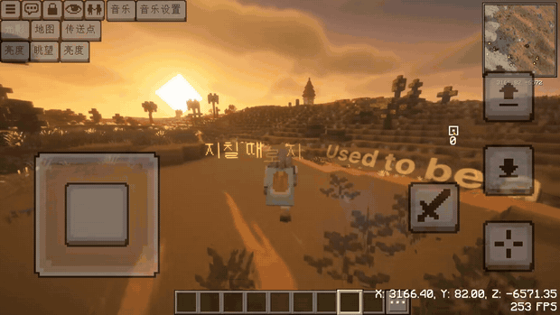</a>

<b>手机版</b> —— 安卓启动器上的完整体验 <a href="assets/videos/手机版效果展示.mp4">完整视频 4:17</a>

</td>
</tr>
</table>

> 上方为自动循环的动图预览，点任意一张可播放完整视频（H.264 MP4，单条均在 30 MB 内）。

---

## 功能

### 8 个聚合音源，一个播放器

<table>
<tr>
<td align="center" width="25%"> <b>网易云音乐</b></td>
<td align="center" width="25%"><a href="https://y.qq.com/">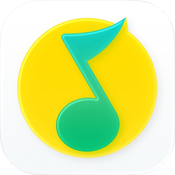</a> <b>QQ 音乐</b></td>
<td align="center" width="25%"> <b>酷狗音乐</b></td>
<td align="center" width="25%"> <b>YouTube Music</b></td>
</tr>
<tr>
<td align="center" width="25%"> <b>哔哩哔哩</b></td>
<td align="center" width="25%"><a href="https://qishui.douyin.com/">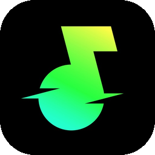</a> <b>汽水音乐</b></td>
<td align="center" width="25%"> <b>Spotify</b></td>
<td align="center" width="25%">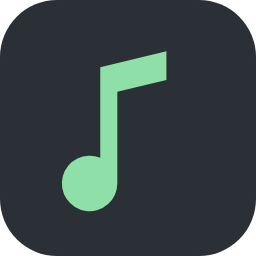 <b>GD 音乐台</b></td>
</tr>
</table>

各家能走到哪一步不一样，下表是**实际可用范围**：

| 音源 | 登录 | 搜索 | 歌单 / 榜单 | 逐字歌词 | 最高音质 |
| --- | --- | --- | --- | --- | --- |
| **网易云音乐** | 扫码 / Cookie，多账号 | 歌曲、歌单、联想、热搜 | 我的歌单、收藏、排行榜、私人 FM、每日推荐 | ✅ | 无损 / Hi-Res / 沉浸 / 母带 |
| **QQ 音乐** | 扫码（QQ 或微信） | 歌曲、歌单 | 账号歌单、发现页 | ✅ | 无损 |
| **酷狗音乐** | 扫码（标准版 / 概念版） | 歌曲、歌单 | 账号歌单、榜单、公开歌单 | ✅ | 八档，最高臻品母带 |
| **YouTube Music** | 免登录，可选贴 Cookie | 歌曲、专辑、电台 | 公开歌单、私人歌单 | 仅逐行 | AAC |
| **哔哩哔哩** | 免登录 / 扫码 | 歌曲、视频、分 P | 收藏夹、公开歌单 | 仅逐行 | 原码率 |
| **汽水音乐** | 扫码 / 贴 Cookie | 歌曲、歌单 | 账号歌单、收藏、发现流、电台 | ✅ | 权益内最高档 |
| **Spotify** | 自备 Client ID | 歌曲、公开歌单 | 本人歌单、喜欢的歌 | — | 不出声，自动换源 |
| **GD 音乐台** | 免登录 | 聚合搜索 | 跨平台歌单 | 视平台而定 | 受额度限制 |
| **LX 自定义脚本** | 导入脚本 | 看脚本 | 看脚本 | 看脚本 | 128k / 320k / FLAC / 24bit |

两个提醒：

- **Spotify 只提供歌单和资料，放不出声。** 官方接口没有音频出口，所以点播时会自动换到别的平台找同一首 —— 就是下面「自动换源」那套。
- **YouTube Music 和哔哩哔哩的歌词是逐行级别的**，不是逐字。能跟着唱，但没有一个字一个字亮起来的效果。

### LX 自定义脚本音源

除了内置的 8 家，你还能把 [lx-music](https://github.com/lyswhut/lx-music-desktop) 社区的音源脚本直接导进游戏 —— 洛雪生态里那些自定义渠道，插上就能用。

导入很简单：从文件选，或者复制一段脚本（复制的是链接会自动下载，是正文就直接用）。**导入即生效**，不用重启。

- 自定义源排在**所有内置音源前面**：它能给出播放链接就用它的，给不出就安静退回内置渠道，**一份坏脚本不会让你没歌听**
- 支持网易云、QQ、酷狗、酷我、咪咕五家渠道。**酷我和咪咕**只有在脚本启用时才可用 —— 这两家本身不单独取流，全靠脚本
> ⚠️ 脚本跑在你本机，**它能发网络请求**。只导入你信得过的脚本来路。

### 自动换源：灰歌不再是灰的

无版权的曲目不再是一行灰字。开启后，官方拿不到音频时按**歌名 + 歌手**去别的平台找同一首歌，找到就直接播 —— 点下去就响，不用管它是从哪家来的。

不满意可以右键手动换源，从候选里自己挑。

### 音效系统：蝰蛇音效 + JamesDSP 混响

游戏里自带两套音效引擎，播放条右下角的调音图标进去就能调，**改完立刻听到**，不用重启也不用等下一首。

**ViPER 蝰蛇音效** —— 安卓上那套蝰蛇音效，在游戏里完整可用：

- 均衡器、低音增强、清晰度、声场环绕、动态系统、胆机染色、混响、限幅……二十多项效果，一项项都能调
- **能直接导入你手头现成的蝰蛇预设文件**（老的 XML 配置文件也认），导出的预设也能拿回手机 App 用
- **内置 8 套现成预设**，含酷狗同款、Dolby Pro Logic II 这类经典配置，装上就能听；你改过的预设不会被覆盖

**JamesDSP 混响** —— 另一套完全不同的混响，**19 个预设**，从「小房间」到「长混响」覆盖各种空间感。它和蝰蛇自带的混响听感差别很大：可以只开一个，也可以两个都开、叠出更厚的尾音。

> 想试的话，先开「大厅 1」或「板式（亮）」，这两个和默认差别最明显。

### 一起听：三种开法，两种不需要服务端

和朋友听同一首歌。**直连与局域网两种开法什么都不用装** —— 服主不装插件、也不用开服务器：

| 开法 | 需要什么 | 房主退出服务器后 |
| --- | --- | --- |
| **服务器房间** | 服主装 mpsync | 房间结束 |
| **直连房间** | 什么都不用装 | **房间照常继续** |
| **局域网房间** | 什么都不用装，同一网络自动发现 | **房间照常继续** |

**直连房间**最好用：房主点开房，复制一条邀请串发给好友，对方粘贴就进来了。房主自己退出那个第三方服务器，房间照样开着 —— 因为房间引擎就在房主的游戏里跑。

房间里还有：

- **民主点歌**：一起排队点歌，投票切歌要过半，投票踢人要 80%
- **会员借流**：房间里有会员的人可以替全房解析，**谁的账号都不会离开自己电脑**。这个默认开着，不想贡献可以关掉
- **房内无缝切歌**：全房跟着同一段过渡，配置低的队友也能听到

### 汽水音乐：用你自己的会员听完整版

在 MC 里真正登录汽水账号，**用你自己账号的 VIP / SVIP 权益听完整版** —— 不是试听片段。这是目前 MC 音乐 Mod 里独一份的能力。

登录两条路，都不用装汽水客户端：

- **扫码**：点一下出二维码，用抖音 App 扫
- **粘贴 Cookie**：从浏览器里复制，粘进去就行 —— 裸 `k=v`、带 `Cookie:` 前缀、devtools 里复制的一整串都能认

登录之后：

- **音质跟着你的账号走**，SVIP 能选到「高清环绕」这些高档位
- 播放条上的音质标签会写清「**你选的** → **实际听到的**」，比如 `无损 → 极高`。两者不一样是正常的 —— 版权、地区、会员权益都会让实得低于所选，至少你知道现在听到的是什么
- **能存 8 个账号随时切换**，换号前会先验一遍，验不过就留在原账号并告诉你原因，不会把你登出
- 音质选档、账号歌单、收藏、发现流、电台、逐字歌词都在

**什么时候只有试听？** 没登录、账号不是会员，或者汽水那套解析服务没起来 —— 这三种情况都会在列表里明确标出「试听」，不会让你听着 30 秒的片段还以为是自己网络有问题。免费曲目不受影响，不登录也能听全曲。

### 逐字歌词

一个字一个字跟着唱，上浮填涂、发光，不是整行整行地跳。

- **十种全屏排版样式**，每种都有独立参数可调
- **3D 世界歌词**：歌词直接画进游戏世界，好几种动效
- **译文与罗马音**都支持，中日英混着听也不怕
- **找错歌词可以直接换源**：列表里中键一点，几个候选逐字预览挑一个，选定后这首歌就一直用你挑的那份
- 歌词来源记在歌上，切歌、重启都不会丢

### 灵动岛

切歌、音量、下载进度、报错，全从顶部胶囊显示。8 种形态、四级优先级调度，播放器收起时动画合入岛。游戏内 **Ctrl+F** 从岛上长出快捷搜索栏，不切出游戏就能找歌。

### Automix 无缝切歌

前一首还没结束，下一首已经铺进来了 —— 中间没有那一下停顿。

它自己找两首歌最合适接上的那一拍：找鼓点、找人声的位置，然后低音对低音、人声让路、节奏卡准、音高对上，听起来就像一首混音过的歌。不喜欢也可以关掉。

低配电脑会自动换成更省力的算法，效果稍差但不会卡。**手机上也能跑，不需要装任何额外东西。**

### 播放体验

- **频谱**：实时频谱跟着音乐跳，HUD 和全屏播放器里都有
- **系统联动**：键盘上的多媒体键、耳机线控都能控制游戏内播放；你在外面用别的播放器，游戏里也会跟着显示那一首
- **游戏内中文输入**：直接敲拼音搜歌，不用切出去
- **液态玻璃界面**：真的边缘折射毛玻璃，15 套主题，字体随便换，颜色跟着封面变
- **桌面歌词**：游戏外也能挂着看词
- **触屏手势**：列表惯性滑动、队列长按拖动排序
- 放歌时自动压掉原版游戏音乐 —— 只让路「音乐」，音效和环境音不受影响

### 全平台

Windows / Linux / macOS / Android，电脑和手机启动器都能跑。

---

## 支持的版本

共 5 个 Minecraft 版本、10 个构建（Fabric 5 个、NeoForge 4 个、Forge 1 个）。

| Minecraft | 加载器 | Java |
| --- | --- | --- |
| 1.20.1 | Fabric / Forge | 17 |
| 1.21.1 | Fabric / NeoForge | 21 |
| 1.21.11 | Fabric / NeoForge | 21 |
| 26.2 | Fabric / NeoForge | 25 |
| 26.3 | Fabric / NeoForge | 25 |

> 1.20.1 那一代配的是 Forge 而不是 NeoForge —— 当时整合包生态还在 Forge 上。

---

## 安装：三步装好

1. **选好版本与加载器** —— 不确定就去看启动器里整合包的详情
2. **装前置** —— Fabric 侧：Fabric API + Fabric Language Kotlin；Forge / NeoForge 侧：Kotlin for Forge
3. **丢进 mods，开听** —— jar 放进 `.minecraft/mods/`，进游戏按 **右 Shift** 打开播放器

Windows 开箱即用；Linux 与安卓首次启动自动补齐组件，按提示重启即可。

产物命名 `MuoniumPlayer-<MC版本>-<加载器>-<mod版本>.jar`。**认准文件名里的 MC 版本号**，1.21.1 和 1.21.11 只差一个字符，装错不会工作。

### 手机上游玩

推荐 [FCL](https://github.com/FCL-Team/FoldCraftLauncher)（[官网](https://fcl-team.github.io/)）、[Zalith Launcher](https://github.com/ZalithLauncher/ZalithLauncher) 等安卓启动器：

- **渲染器**：26.3 用 [MobileGL](https://github.com/MobileGL-Dev/MobileGL)（已实测适配）；其它版本建议 [MobileGlues](https://github.com/MobileGL-Dev/MobileGlues-release) 并关闭 ANGLE，Zink / VirGL 等 Mesa 渲染器也已适配
- **触屏手势**：列表惯性甩动、队列长按拖动排序，全手势支持
- **Automix**：安卓上纯本地推理，不需要装任何额外环境

| 组件 | 用途 | 地址 |
| --- | --- | --- |
| FCL | 安卓启动器 | [GitHub](https://github.com/FCL-Team/FoldCraftLauncher) · [官网](https://fcl-team.github.io/) |
| Zalith Launcher | 安卓启动器 | [GitHub](https://github.com/ZalithLauncher/ZalithLauncher) |
| MobileGL | 26.3 推荐渲染器 | [GitHub](https://github.com/MobileGL-Dev/MobileGL) |
| MobileGlues | 其它版本推荐渲染器 | [GitHub](https://github.com/MobileGL-Dev/MobileGlues-release) |

---

## 常见问题

**装上后界面一个像素都没有？**
屏幕上会有一块原版字体的提示，告诉你缺什么、下一步做什么，照着走即可；手机端先检查渲染器选择（见上）。

**歌词匹配错了 / 想换歌词来源？**
播放器里可以手动指定歌词来源，译文、罗马音都支持。

**服务器玩家怎么一起听？**
服主装 mpsync 开服务器房间；不想动服务器就用直连或局域网房间，完全不需要服务端。

---

## 社区与反馈

### QQ 群 · 27635246

**「Melodify & MuoniumPlayer 的联动小屋喵」**

<a href="https://qm.qq.com/q/uNHkCoTusU">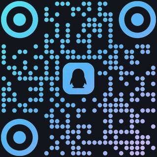</a>

**<a href="https://qm.qq.com/q/uNHkCoTusU">点此加群 →</a>** 或扫码

四位作者都在群里 · 报问题、提建议、抢先看新版本

**遇到问题请带上版本号与日志** —— 版本号在播放器设置里能看到，日志是 `.minecraft/logs/latest.log` 或 `latest.log`。带上这两样，问题基本能当场定位。

其他渠道：

- **官网与下载：[melodifymc.cc.cd](https://melodifymc.cc.cd/)**
- **MC 百科：[mcmod.cn/class/30544](https://www.mcmod.cn/class/30544.html)** —— 也可在那边留言
- 本仓库 [Issue](../../issues)，同样附上日志与版本号

---

## 赞助

**<a href="https://afdian.com/a/xinshibaobao">afdian.com/a/xinshibaobao</a>**

<a href="https://afdian.com/a/xinshibaobao">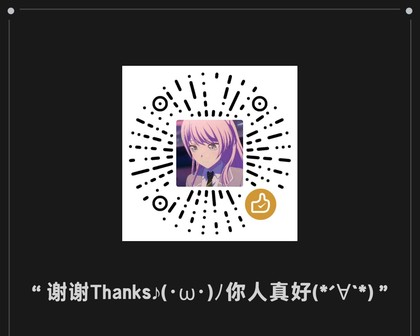</a>

扫码或点开链接 —— 由作者 <b>心事抱抱</b> 的发电页统一接收

MuoniumPlayer 由**四位开发者**共同维护：心事抱抱、云杉、N0ne、eyz2021。项目长期开源，音频由各平台 CDN 直发，服务器与流量开销自理。

**赞助完全自愿 —— 不赞助，功能一个都不少。** 所有核心功能、全部音源和免费下载渠道始终对所有人开放。

关于渠道，有三点要说明：

- **只认爱发电这一个入口。** 除上面的爱发电页面外，我们没有开通、也不会授权任何其他收款方式。任何以本项目名义在别处收钱的，都与我们无关
- **赞助不换取特权。** 不设付费版、不解锁功能、不进入更新优先队列 —— 赞助就是单纯的支持
- **高速下载与赞助是两件事。** 需要高速通道请走官网下载页的流程，请不要把上面的赞赏码当作解锁入口

也可以不花钱地帮忙：**提 Issue、在群里帮新玩家解答、把项目分享给朋友** —— 这些同样珍贵。

---

## 关于这个项目

MuoniumPlayer 是一个 **Minecraft 音乐播放器 Mod**，把完整的音乐客户端搬进游戏里。适合这些场景：

- 想边玩 MC 边听网易云或 QQ 音乐的歌单，但不想切窗口
- 服主想给服务器加个音乐系统，又不想让每个玩家额外装客户端
- 玩整合包 / 空岛 / 建筑服时想要游戏内电台和歌词
- 和好友远程一起听歌

**关键词**：Minecraft 音乐播放器、我的世界音乐 Mod、Minecraft 内置音乐、游戏内听歌、MC 听歌 Mod、网易云音乐 Minecraft、QQ 音乐 Mod、酷狗音乐 Mod、汽水音乐 Mod、逐字歌词 Mod、3D 歌词、游戏内歌词显示、一起听、同步听歌、无缝切歌、Fabric 音乐 Mod、Forge 音乐 Mod、NeoForge 音乐 Mod、Minecraft music player、in-game music mod、Minecraft Spotify。

支持 **1.20.1 / 1.21.1 / 1.21.11 / 26.2 / 26.3**，加载器 **Fabric / Forge / NeoForge**，平台 **Windows / Linux / macOS / Android**。

---

## 第三方许可与致谢

界面能画得出来、歌词能对上拍子、脚本能跑起来，靠的是这些项目：

| 项目 | 在本项目中的角色 |
| --- | --- |
| [Skija](https://github.com/JetBrains/skija) / [Skia](https://skia.org/) | 界面渲染后端 —— 整套 GUI 走独立 Skia 渲染层，不依附原版 GUI |
| Liquid Glass | squircle 物理距离场透镜实现参考（MIT） |
| [lx-music-desktop](https://github.com/lyswhut/lx-music-desktop) | 自定义音源的脚本协议 |
| [Closure Compiler](https://github.com/google/closure-compiler) 与 [Rhino](https://github.com/mozilla/rhino) | 脚本转译与执行 |
| [ytmusicapi](https://github.com/sigma67/ytmusicapi) | YouTube Music 链路的协议实现参考 |
| [AMLL TTML](https://github.com/amll-dev/amll-ttml-db) | 歌词格式支持 |
| [ModernUI](https://github.com/BloCamLimb/ModernUI) 与 [OneConfig](https://github.com/Polyfrost/OneConfig) | HUD 设置的可选集成 |
| Melodify（modernMP） | 同源联动项目 —— 与本客户端共用一套房间协议的另一个客户端 |
| MusicParty（mpsync） | 托管「服务器房间」的服务端组件 |
| [folia-major](https://github.com/chthollyphile/folia-major) | 视觉灵感来源（绘光歌词样式） |

---

## 隐私

**账号凭据只存在你自己的电脑上**，位于 `.minecraft/config/muonium/`，界面不显示 Cookie 明文，也不会传给任何第三方。

- **贡献会员解析**默认开启，关掉不影响你自己听歌。开着时**只上传带签名、有时效的临时播放直链**，绝不上传账号凭据
- **网易云听歌历史同步**是可选的，首次开启前会先展示数据上报说明
- **更新检查**最多每 30 分钟拉一次清单、只在主菜单提示一次；可以「先不更新」跳过版本。客户端**永远不会自动下载或替换 jar**
- 自定义音源脚本有沙箱与预算封顶，但仍能发网络请求 —— 只导入可信来源

---

## 免责声明

本 Mod 只调用各音乐平台**客户端可见的公开接口**，不破解、不绕过付费内容，**也不提供任何音频文件** —— 所有音频由各平台 CDN 直发。

使用者需遵守各平台服务条款与所在地版权法规。本 Mod 与各音乐平台无隶属或合作关系；所有平台名称与商标归各自权利人所有。

---

## 许可

本项目以 Apache-2.0 开源 —— 允许自由使用、修改与再分发（含整合包内置、镜像与二次打包）。

- 完整许可文本见 [LICENSE](LICENSE)，第三方署名见 [NOTICE](NOTICE)
- 随包分发的第三方组件（Skia / Skija 等）许可全文见各版本目录下的 `licenses/`

分发时请随附本许可与 NOTICE；对修改过的文件标明改动；保留原有版权与署名声明。

Minecraft 是 Mojang AB 的商标，本项目与 Mojang AB 无关。
